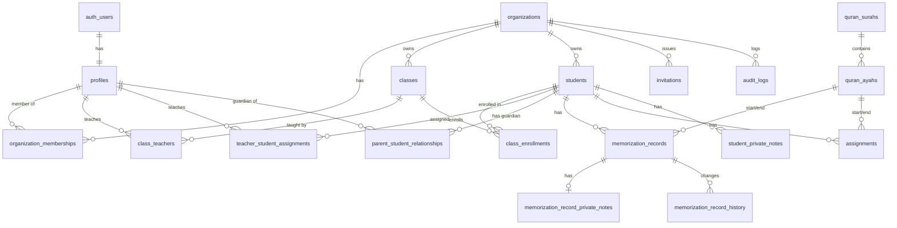

# Database Design

Status: Phase 0 draft — to be reviewed before writing migrations.
Engine: Supabase PostgreSQL. All app tables use `uuid` primary keys (`gen_random_uuid()`), `timestamptz` timestamps, and RLS enabled.

## 1. ER diagram (pilot + Release 1 core)

## 2. Enums

| Enum                  | Values                                                                                           |
| --------------------- | ------------------------------------------------------------------------------------------------ |
| `membership_role`     | `admin`, `teacher` (later: `student`)                                                            |
| `membership_status`   | `active`, `revoked`                                                                              |
| `record_status`       | `active`, `archived`                                                                             |
| `relationship_status` | `pending`, `verified`, `revoked`                                                                 |
| `assignment_type`     | `memorization`, `revision`                                                                       |
| `assignment_status`   | `assigned`, `in_progress`, `student_reported`, `teacher_verified`, `needs_practice`, `cancelled` |
| `performance_rating`  | `excellent`, `very_good`, `good`, `needs_improvement`, `not_completed`                           |
| `invitation_type`     | `teacher`, `parent`                                                                              |

Display labels come from translation files, not the enum values.

## 3. Tables

### Reference data (read-only for everyone signed in)

**`quran_surahs`** — `surah_number smallint PK (1–114)`, `name_arabic`, `name_english`, `transliteration`, `ayah_count`.

**`quran_ayahs`** — `surah_number` FK, `ayah_number`, `page_number (1–604)`, `juz_number (1–30)`, `hizb_quarter (1–240)`. PK `(surah_number, ayah_number)`. 6,236 rows (Hafs).
Source: Tanzil.net Quran metadata (Hafs, Madani Mushaf). **Check the license and add attribution before launch.**

### Identity and tenancy

**`profiles`** — `id PK → auth.users`, `display_name`, `preferred_language ('ar'|'en')`, timestamps. Created by a trigger on sign-up.

**`organizations`** — `id`, `name`, `slug unique`, `organization_type`, `preferred_language`, `timezone`, `riwayah default 'hafs'`, `contact_email?`, `contact_phone?`, `status`, timestamps.

**`organization_memberships`** — `id`, `organization_id`, `user_id`, `role`, `status`, `joined_at`, timestamps.
Unique `(organization_id, user_id, role)`. A solo teacher has two rows: `admin` and `teacher`.

### Classes and students

**`classes`** — `id`, `organization_id`, `name`, `description?`, `status`, timestamps.

**`class_teachers`** — `id`, `organization_id`, `class_id`, `teacher_user_id`, `created_at`. Unique `(class_id, teacher_user_id)`.

**`students`** — `id`, `organization_id`, `display_name`, `status`, `enrollment_date`, timestamps. **No notes column** (see `student_private_notes`).

**`student_private_notes`** — `id`, `organization_id`, `student_id`, `author_id`, `body`, timestamps. Staff only.

**`class_enrollments`** — `id`, `organization_id`, `class_id`, `student_id`, `start_date`, `end_date?`, `status`. Partial unique index: one active row per `(class_id, student_id)`.

**`teacher_student_assignments`** — `id`, `organization_id`, `teacher_user_id`, `student_id`, `start_date`, `end_date?`, `status`. Optional direct assignment outside a class.

**`parent_student_relationships`** — `id`, `organization_id`, `parent_user_id`, `student_id`, `relationship_type?`, `status`, timestamps. Unique `(parent_user_id, student_id)`.

### Learning records

**`memorization_records`**

- `id`, `organization_id`, `student_id`, `teacher_user_id`, `lesson_date`
- `start_surah`, `start_ayah`, `end_surah`, `end_ayah`
- `performance_rating`, `accuracy_score smallint? (0–100)`, `mistake_categories text[]?`, `tajweed_assessment?`
- `parent_visible_feedback?`
- `idempotency_key uuid`, `status` (`active` | `deleted`), `deleted_reason?`
- `created_by`, `updated_by`, timestamps

**`memorization_record_private_notes`** — `record_id PK/FK`, `organization_id`, `body`, `updated_by`, timestamps. Staff only.

**`memorization_record_history`** — `id`, `organization_id`, `memorization_record_id`, `changed_by`, `change_type`, `reason?`, `previous_values jsonb`, `new_values jsonb`, `created_at`. Written by a trigger. Append-only.

**`assignments`**

- `id`, `organization_id`, `student_id`, `assigned_by`, `assignment_type`
- `start_surah`, `start_ayah`, `end_surah`, `end_ayah`
- `assigned_date`, `due_date?`, `priority? (revision only)`, `instructions?`
- `status`, `student_reported_completed_at?`, `teacher_verified_at?`
- `source_record_id? → memorization_records` (the lesson that created it)
- `idempotency_key uuid`, timestamps

### Invitations and audit

**`invitations`** — `id`, `organization_id`, `invitation_type`, `intended_role?`, `email?`, `student_id?`, `token_hash bytea unique`, `expires_at`, `accepted_at?`, `accepted_by?`, `revoked_at?`, `created_by`, `created_at`.
The raw token is 32 random bytes, shown once as a link; only its SHA-256 hash is stored.

**`audit_logs`** — `id`, `organization_id?`, `actor_user_id?`, `action`, `entity_type`, `entity_id`, `metadata jsonb`, `created_at`. Insert only through functions/triggers. No update or delete.

## 4. Integrity rules (enforced in the database)

1. **Valid passage:** composite FKs `(start_surah, start_ayah)` and `(end_surah, end_ayah)` → `quran_ayahs`. This rejects bad surah/ayah numbers.
2. **Ordered passage:** `CHECK ((start_surah, start_ayah) <= (end_surah, end_ayah))`.
3. **Same-org links:** composite FKs such as `(organization_id, student_id) → students(organization_id, id)`, so a row can't point at another organization's student or class. Each parent table gets `unique (organization_id, id)`.
4. **No duplicate saves:** unique `(organization_id, idempotency_key)` on records and assignments.
5. **Assignment status rules:** `teacher_verified` requires `teacher_verified_at`; the status-change function rejects invalid moves (e.g. student-reported can't become verified without a teacher).
6. **History kept:** records are soft-deleted (`status = 'deleted'` + reason), never hard-deleted by app users.
7. **`updated_at`** maintained by a shared trigger.

## 5. Indexes (starting set)

- `organization_memberships (user_id) where status = 'active'`
- `class_enrollments (student_id) where status = 'active'`, `(class_id) where status = 'active'`
- `class_teachers (teacher_user_id)`
- `parent_student_relationships (parent_user_id) where status = 'verified'`
- `memorization_records (student_id, lesson_date desc)`
- `assignments (student_id, status)`, `(organization_id, due_date) where status in ('assigned','in_progress')`
- `quran_ayahs (page_number)`, `(juz_number)`

## 6. RPC functions (transactional writes)

| Function                                          | Does                                                                                                                                                   |
| ------------------------------------------------- | ------------------------------------------------------------------------------------------------------------------------------------------------------ |
| `create_organization(name, …, also_teacher bool)` | Org + admin membership (+ teacher membership) + audit.                                                                                                 |
| `create_invitation(org, type, role, student_id?)` | Checks issuer rights; returns the raw token once.                                                                                                      |
| `accept_invitation(token)`                        | Hash → find valid, unexpired, unrevoked, unused row → create membership or verified parent link → mark accepted + audit. Locks the row (`for update`). |
| `enroll_student(org, name, class_id)`             | Student + enrollment.                                                                                                                                  |
| `record_lesson(payload)`                          | Record + private note + next memorization/revision assignments; idempotent.                                                                            |
| `update_assignment_status(id, status)`            | Enforces allowed transitions by role.                                                                                                                  |
| `correct_record(id, changes, reason)`             | Update + history row.                                                                                                                                  |

Functions are `security invoker` where possible. Those that need `security definer` (accept invitation, create organization) set `search_path = ''` and check `auth.uid()` themselves.

## 7. Migrations

- Location: `supabase/migrations/`, created with `supabase migration new <name>`.
- Planned order: `0001_extensions_enums` → `0002_quran_reference` → `0003_identity_tenancy` → `0004_classes_students` → `0005_records_assignments` → `0006_invitations_audit` → `0007_rls_helpers_policies` → `0008_rpc_functions`.
- Quran data is loaded by a seed/migration from a checked-in CSV with source and license notes.
- Applied locally with `supabase db reset`. Promoted to staging and then production with `supabase db push` after review.
